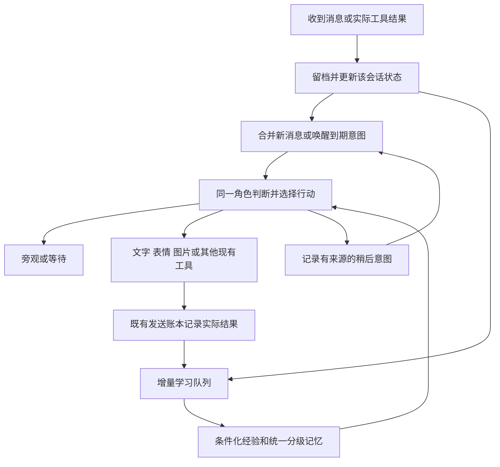

自主聊天与成长机制深入调研 · 2026-10-28

这轮是方案调研，没有修改机器人运行代码、设置或服务器，没有安装外部插件，没有发送测试聊天，也没有提交或推送 Git。公开源码摘取保存在 `artifacts/autonomy-research-20261028/sources/`，来源、版本与校验值见同目录上一级的 `source-manifest.json`。抓取失败的文件在清单中明确标错，不当作已读依据。

**结论与上版方案的修正**

目标应当是让同一个角色持续理解聊天、选择行动、保留未完成意图，再通过真实反馈修正相处方式。单独增加主动回复概率、情绪数值或日记，都不足以构成这个闭环。

模型空闲时不会自行产生新的调用。何时唤醒由常驻服务提供机会；是否开口、对谁说、用什么表达，则可以交给模型。合理实现是事件驱动的会话状态机，不需要全天不停询问模型“现在想说什么”。

上一版有两点需要更精确：当前代码已经支持模型选择沉默，并能在该路径提交学习提议；缺口在于被本地参与门槛直接跳过的批次不会走这一模型学习路径，不能把它简单描述成“完全不会旁听学习”。另外，“生成日记”必须和后续行为的实际变化分开评价，不能仅凭日记内容宣称成长。

**实际核对的外部实现**

| 来源 | 代码或文档呈现的机制 | 对本项目的取舍 |
| --- | --- | --- |
| [作者的插件分享视频](https://www.bilibili.com/video/BV1ednc6jE3j/)对应的 [dsh-speak-up](https://github.com/Yuuyuko-uu/dsh-speak-up/blob/main/lib/host.js) | 本地时间与随机判定决定是否向现有 agent 投递一次 followup；真正生成内容仍调用模型 | 可借鉴唤醒与正式对话共用上下文和工具；随机只调节机会，不替代语义判断。视频是查阅页面说明，没有完整观看或取得全文字幕 |
| [dsh-fish-memory](https://github.com/Yuuyuko-uu/dsh-fish-memory/blob/8b3571da94d8bafd12f746ad4b2035186f5c014c/lib/index.js) | 时间衰减、长期资料分类、相关证据门槛与排序分开，排除被取代资料 | 保留重要而久远的资料；“新鲜”不能让无关记忆挤入当前话题。这里只适用于长期资料召回，不能拿来删减最近 40 条上下文 |
| [dsh-feiyu-mood](https://github.com/Yuuyuko-uu/dsh-feiyu-mood/blob/4e21024445127b2218a2a3bfa5bdb2f067e3890c/lib/index.js) | 回合结束后异步调用模型判断变化；状态随时间回稳；显著变化才进入上下文，并记录是否已注入 | 借鉴缓慢变化、低把握不定调、避免重复注入；不照搬每轮额外模型调用，也不照搬作者专用的关系和情绪设定 |
| [dsh-bili-whale 调度代码](https://github.com/Alterssss/dsh-bili-whale/blob/8b0009f8ce2ebdc421afcb2e727b19ac18912ec6/lib/scheduler.js)及[设计说明](https://github.com/Alterssss/dsh-bili-whale/blob/8b0009f8ce2ebdc421afcb2e727b19ac18912ec6/VISION.md) | 调度唤醒后仍有明确的阅读、挑选、分享与经历记录流程 | 借鉴真实素材和未说想法的持续性；不照搬随机“不想看”、把用户沉默解释成关系冷淡等个人化设计 |
| [humanism 人格积累说明](https://github.com/InariNGT-Ofiicial/dsh-bili-humanism/blob/22b29afb5628c9930bc25bb6680ed96e88458a63/docs/PERSONALITY.md)及[互动记录结构](https://github.com/InariNGT-Ofiicial/dsh-bili-humanism/blob/22b29afb5628c9930bc25bb6680ed96e88458a63/lib/personality-shadow.mjs) | 互动认识保存来源、处境、其他解释、反例与不确定性；可跳过、修订和撤回 | 学到的是“何时这样回应更合适”，而不是永久规定“某人就是这样的人”。沿用现有统一记忆库，不再增加第二套人格文件作为独立真源 |
| [MaiBot Focus 决策提示](https://github.com/Mai-with-u/MaiBot/blob/6bcb2e068cd98793a132cb8cc4ebf3cc00cb8fc3/prompts/zh-CN/maisaka_chat_focus.prompt)和[会话运行代码](https://github.com/Mai-with-u/MaiBot/blob/6bcb2e068cd98793a132cb8cc4ebf3cc00cb8fc3/src/maisaka/focus/group_runtime.py) | 持续接入新消息，模型可选择工具、等待或结束；消息到达与工具执行有先后关系 | 借鉴可持续的行动状态；保留各群和私聊的上下文隔离，不复制跨聊天共用完整上下文，也不强制增加规划器和回复器两次串行调用 |

以上是对所读版本的机制核对，不代表已运行这些项目或验证其长期表现。视频或代码注释里的召回率、成本、成长效果，没有在本项目复现，不采用为效果承诺。

[DeepSeek Harness 官方架构](https://github.com/deepseek-ai/deepseek-harness/blob/master/docs/architecture.md)显示其能力建立在会话、事件、模型及工具等组件之上。对当前 Linux 微信项目而言，可以在既有 Python 核心中实现对应能力，没有必要为了“自主”先迁移整个框架。

**与现有项目的真实差距**

| 本地代码位置 | 已有能力 | 建议补齐的部分 |
| --- | --- | --- |
| [conversation.py](D:/appData/qqbot/wechat-linux/whalegirl_linux/conversation.py:61) | 根据参与模式、近期发言、时段及兴趣信号决定是否让模型处理 | 减少把语义机会先硬挡掉的情况，采用消息合并与会话状态控制判断频率；明确求助与普通插话分开 |
| [runtime.py](D:/appData/qqbot/wechat-linux/whalegirl_linux/runtime.py:788) | `should_reply=false` 可旁观，仍提交本轮学习提议 | 观察与学习不应只依赖进入主回复流程的消息；为未处理消息补上独立的增量学习游标 |
| [proactive.py](D:/appData/qqbot/wechat-linux/whalegirl_linux/proactive.py:229) | 低优先级主动开聊、模型选择沉默、发送前核对新消息、沿用发送账本 | 让未完成话题和具体意图驱动下次机会，并与普通接话共用一致的上下文组装及动作解释 |
| [conversation.py](D:/appData/qqbot/wechat-linux/whalegirl_linux/conversation.py:227) | 情绪持久化及时间回稳 | 当前变化主要由关键词产生；逐步改成主模型顺带提交有依据的轻量变化，避免看见一个词就切换整套语气 |
| [conversation.py](D:/appData/qqbot/wechat-linux/whalegirl_linux/conversation.py:254) | 按时段提供生活片段，可附带近期贴吧标题 | 将角色背景和真实活动分开。获取过帖子标题不等于已读全文；时间轮换场景也不能成为真实经历证据 |
| [conversation.py](D:/appData/qqbot/wechat-linux/whalegirl_linux/conversation.py:551) | 模型规划原生表情，也可按模型建议概率补发 | 明确的模型表情动作不再经过另一轮随机“愿不愿意发”；表达偏好影响模型选择，发送额度仍沿用现有设置 |
| [learning.py](D:/appData/qqbot/wechat-linux/whalegirl_linux/learning.py:543)与[memory_hub.py](D:/appData/qqbot/wechat-linux/whalegirl_linux/memory_hub.py:1) | 同轮学习提议、持久队列、统一等级、来源、修订与撤回 | 增加条件化的行为经验及反馈关联；不要重建另一份长期记忆库 |

这里核对的是本地工作区，工作区存在其他未提交内容，不能把所有本地行为都当成已部署的线上行为。本轮没有为了调研而操作线上服务。

**建议的会话循环**

普通发言以一批连续消息为单位判断，不为每一条短句都起一个模型回合。判断仍带最近 40 条完整记录及现有媒体说明，上限由后台调整。早于近期窗口的资料继续通过已有记忆工具或召回取得。

单次普通判断同时完成是否参与、文字、表情、需要的工具、少量学习提议及可选状态变化。选择旁观是本批处理的完整结果；没有新消息、新工具结果或到期意图时，不反复问同一段历史。

等待分两种：现有最长 10 秒的接话等待，用于明显没说完的话；未来意图用于“答辩后问问结果”“出现相关新帖再分享”等较长的接续。等待当前会话不能锁住其他会话，意图不能变成强制到点发送。

正在生成时出现新消息，不应每条都取消重算。先缓存；待本轮可安全接入的位置继续处理。若发送对象、指代或话题已发生实质变化，可以撤回尚未发送的旧计划，交回模型更新。短小且仍成立的回答不必每次追加一次模型核对。

**让意图产生主动性**

建议增加一个轻量的意图记录，存放：来源消息、目标会话及人物、想做什么、最早考虑时间、失效时间、适用条件和状态。它不保存待发的固定台词；到合适机会时，根据最新消息生成发言。

例如群友说“明天下午答辩”，模型可以提出一个次日晚些时候的关心意图。如果对方已经主动说“过了”，该意图在当前话题中完成或取消，不再单独追问。它也可以判断对方不想被追问，不创建任何意图。

意图与实际发送分别留档。核心重启后恢复未过期的考虑机会，不能把旧草稿直接补发；已发送或发送结果不确定的动作仍遵守现有账本，不自动重复。现有最多两次发送尝试及“不确定留档、后续聊天继续”的规则保留。

**成长记录需要能指导下一次行动**

| 类型 | 记录例子 | 如何影响聊天 |
| --- | --- | --- |
| 人物事实与偏好 | 某人明确说不喜欢吃辣，后来又明确修正了程度 | 用最新有效值回应，旧值保留修订，按真实微信身份认人 |
| 共同经历 | 本群某次游戏输了后形成的一个具体玩笑 | 相关话题中可回调，不能强行插入每次闲聊，也不能借到另一个群冒充共同经历 |
| 相处经验 | 对方只是抱怨时，先接住情绪比立即列建议更合适 | 在相同处境中影响回应方式，不固定复制某句安慰 |
| 工具经验 | 图库工具返回没匹配到，对方并没有要求新画 | 学会解释实际结果，而非随意改成生成新图；经验必须关联真实工具回执 |
| 角色自身认识 | 看过某类创作后形成一个可修正的兴趣或看法 | 影响以后愿意看什么、聊什么；不能把角色自述反过来当成外界事实证据 |

经验在现有记忆记录上扩展适用场景、反例、来源和反馈即可。明确纠正可以快速生效；从相处中推断的经验先作为候选，经过新的独立依据再提高稳定性。没有新认识就不新增条目，原有好用经验可被修订而非无限追加。

一个合格经验可以是：“对方明确表示只想吐槽时，先回应具体烦恼，再看是否需要建议；若对方直接问怎么办，则及时给办法。”不应是“此人讨厌建议”或“以后每次都先安慰”。

旁听学习使用独立的已观察消息游标，累计有新信息的一批材料后才整理。它可以理解成员之间的对话，但事实和关系的归属仍需来源支持；引用、转发与玩笑不能直接归给当前发言人。模型自身的重复发言、日记和旧反思不计作新增独立证据。

[Generative Agents](https://arxiv.org/html/2304.03442v2)研究通过观察、计划与基于记忆的反思改善行为可信度，同时也记录了记忆细节被添饰的问题。因此本方案将反思保留为可修正认识，并要求回到来源。该研究不是本微信机器人的长期效果证明。

[Reflexion](https://arxiv.org/abs/2303.11366)提供了将反馈整理为后续可用文本经验、无需更新模型权重的思路。本项目采用的反馈优先是明确纠正和实际工具结果，不能把任务类基准成绩直接换算为聊天效果。

[LongMemEval](https://arxiv.org/abs/2410.10813)将信息提取、跨会话推理、时间、知识更新和未知时不编造分开评估。对应本项目，除了“记得什么”，还应核对“现在还对不对”“属于谁、哪一群”和“资料没说过时是否承认不知道”。

**情绪、好感度与表情的分工**

好感度是对某个人相处倾向的慢变量；当前情绪是较快变化、会回稳的状态；长期人设是稳定底色。三者不能互相替代，更不能让“今天兴奋”把所有人的好感度一起提高。

推荐主模型在正常判断中可选提交小幅状态变化，带简短事件依据，没有变化就留空。程序只做本地幅度与来源处理，不再每回合额外请求一遍“心情模型”。跨会话共用角色连续性，具体关系、隐私与当前话题仍按范围使用。

情绪影响表达倾向，不要求每句把情绪说出来。公开群仍按朋友的亲近程度讲话，私聊的暧昧不搬进群。表情是可独立选择的非语言行动，不是文字回复后的附件任务；同样可以不用文字，也可以不用表情。

真实读过的帖子、识别过的图片和实际互动可以成为经历。角色背景片段可用于符合人设的表达，但不能自动长成“我今天确实出门了”之类长期事实。

**工具自主使用如何教给模型**

固定工具说明写清用途和适用例子，放在稳定前缀。每轮动态材料只告诉它当前可用候选、真实结果和少量相关经验。模型可以先判断有没有需要，再调用对应工具；“积极性高”表示更愿意发现适用机会，不表示每轮必须用工具。

把“有新素材但未分享”和“已经向这个群分享过”分开。分享、图库检索与新图生成继续保持不同工具和来源标记。角色的兴趣可以影响愿不愿意找素材，但不能覆盖用户明确指定的图库来源、最新入库优先等既有行为。

明确要求执行的普通任务仍应及时完成。自主旁观主要适用于群聊闲谈、表情互动和主动插话，不能扩展成随机忽略直接请求。

**速度、费用与缓存**

- 空闲唤醒采用本地事件和到期时间，检查本身不调用模型。没有变化时只等待；避免每隔几分钟对所有会话空转。例如每 5 分钟一次、全天执行就是 288 次考虑机会，若每次都请求模型，用量会在没人说话时增长。
- 普通聊天采用一个主判断同时给出动作和少量提议，主动聊天也复用同一人设与工具组装。实际调用搜索等工具时仍可能需要后续模型回合，不能承诺所有情况只有一次调用。
- 后台成长只消费增量材料、合并相近认识。收到新聊天时让路，不占用原生微信发送锁，不修改运行配置来实现每次学习。
- 固定人设、工具定义与共同规则保持稳定；当前情绪、意图和检索资料放动态部分。背景整理产生的新经验按批生效，避免不停改写提示词前缀。
- 动态上下文继续使用用户要求的 40 条；分离并限制长期资料的预算，不以本次改造为由重新削减上下文、忽略表情或用关键词筛掉近期消息。
- 统计上区分普通回复、主动考虑、主动发送、后台成长、工具后续调用；缓存命中和耗时用同模型、相近负载的实际记录比较。不预先承诺具体提升比例。

**控制台与实施顺序**

界面提供自主行为总开关，分开即时接话、主动开聊与后台成长；常用调节保留参与程度、主动程度、表情偏好、成长速度。高级参数可以收起，不用几十个冷却和分数让管理员猜。

管理员可以看到“这批旁观/回复的简短原因”“未完成意图”“学到了什么及来源”“是否已影响后续行动”。展示可核查的行为依据和变化，不要求或保存模型完整内部思考。记忆仍支持编辑和撤回。

“拷打牢达”既有 @、拍一拍、关键词唤醒边界保留；自主行为在已授权范围内工作。人格可以逐渐形成兴趣和相处习惯，但不通过学习自动扩大联系人、会话或管理权限。

建议按三步实施：

1. 统一已有回复、主动聊天和表情决策，接入同会话增量消息；保留兼容开关，先解决决定沉默和表情表达的体验。
2. 加入可过期、可完成、可取消的接续意图，让主动开口有实际依据，复用现有发送结果与去重机制。
3. 补足旁听学习、条件化经验和缓慢状态变化，接入现有分级记忆与管理员查看，最后按实际反馈调整倾向。

有意义的验收只需覆盖少数实际场景：别人互聊时可旁观但保留材料；连发短句只处理一轮；可只发表情；直接任务及时完成；话题变化后旧意图取消；一次明确纠正影响后续回答；群内信息不串到其他会话；没有新消息时不连续空调模型。这些是后续实施验收目标，本轮没有做真实聊天验收。
