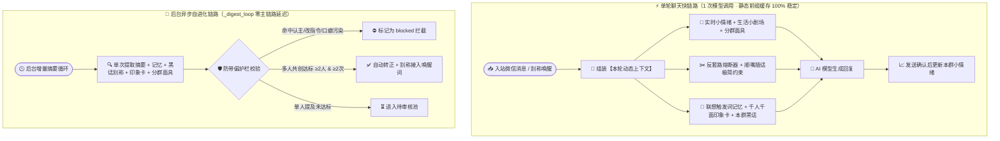

# 真人感人格、联想记忆、千人千面印象卡与防带偏自进化说明

_Linux 微信机器人 · 更新于 2026 年 10 月 26 日（北京时间）_

---

## 📋 概览

本轮升级围绕“如何让机器人在微信群与私聊中真正像一个有情绪起伏、有共同经历、能看人下菜碟、会自然融梗且不会被群友恶意调教带偏的活人朋友”展开，在不增加主聊天链路额外模型调用、不破坏静态系统提示词 Prefix Cache、不引入高内存本地向量模型（严守 `1.77GB` 容器内存红线）的前提下，完成了五大维度的闭环升级：

1. **动态人格三件套（Persona）**：实时小情绪状态机（`MoodState`）+ 后台个人生活小剧场（`DailyLifeState`）+ 分群性格面具（`GroupMask`）。
2. **联想触发记忆与自我言行记忆（Memory）**：零内存开销的联想触发词（`triggers`）+ 情绪刻骨度星级（`salience` 1～5 星）+ 时间半衰期自然衰减 + 机器人自身言行/Flag（`self_stance`）与共同名场面（`shared_moment`）记录。
3. **千人千面关系印象卡（Affection Profile）**：在好感度分值之上，为每位群友建立专属称呼（`nickname`）、性格标签（`vibe_tags`）、专属相处指南（`interaction_rule`）、代表性互动记忆（`notable_events`）与印象卡锁定开关（`profile_locked`）。
4. **去 AI 腔回复引擎（Anti-Formula & Ultra-Short Chime-in）**：自动扫描近 5 轮自身发言的重复起手词、高频自称与连续句尾反问号并当轮熔断；区分“被点名正经聊”与“群聊顺嘴插话（2～18 字极简短反应）”。
5. **后台异步自进化与防带偏护栏（Self-Evolution & Anti-Poisoning）**：复用后台 `_digest_loop` 顺带提取本群黑话（`slang`）与机器人谐音别称（`bot_alias`，如“碗粥”），通过多人提及共创阈值（默认 $\ge 2$ 人、$\ge 2$ 次、置信度 $\ge 85\%$）自动转正并接入群聊唤醒词；对认主/改指令/强制句尾口癖等恶意调教直接拦截为 `blocked`。

---

## 🛠️ 核心机制与配置说明

### 1. 动态人格与去人机感引擎（`whalegirl_linux/conversation.py`）

- **实时小情绪状态机（`persona_mood_state` 表）**：
  - 状态集合：`normal`（平静摸鱼）、`proud`（被夸/投喂得瑟）、`flustered`（脸红过载）、`grumpy`（被怼傲娇炸毛）、`hyped`（吃瓜兴奋）、`sleepy`（深夜犯困）。
  - 每次回复发送后，`update_mood_after_turn()` 根据本轮互动内容平滑调整当前群的情绪与活力值，并按 `mood_half_life_minutes`（默认 25 分钟）向日常基线自然衰减。
- **后台生活小剧场（`current_life_scene`）**：
  - 按北京时间段（早间/午饭/下午/晚间/深夜）结合近期贴吧浏览帖子（如有）生成一句话当下状态，仅在被问及近况或话题契合时自然带出，避免每句硬扯白米饭。
- **分群性格面具（`persona_group_masks` 表）**：
  - 在不改动角色核心设定的前提下，允许每个群在 `[-1, +1]` 档范围内微调 `teasing_delta`（吐槽偏移）、`banter_delta`（玩梗偏移）与 `guard_level`（`relaxed` / `normal` / `guarded`）。
- **反套路熔断器（`anti_formula_check`）**：
  - 扫描当前会话最近 5 条自身回复：若同一起手词（如 `哼`、`不是`、`哎呀`）出现 $\ge 2$ 次、同一自称（如 `本鱼`、`本鲸鱼`）出现 $\ge 2$ 次，或连续 $\ge 3$ 条以问号 `？` 结尾，本轮动态注入强制禁用约束。
- **顺嘴插话极简模式（`chime_in_ultra_short`）**：
  - 在群聊 `natural=True`（未被 @ 或关键词直接点名，仅顺嘴接话）时，强制要求模型用 2～18 字短吐槽/起哄/短反应一击脱离，严禁解释和总结。

### 2. 联想触发记忆与防打脸自我记忆（`whalegirl_linux/memory.py`）

- **新增字段（SQLite 自动平滑迁移）**：
  - `triggers TEXT`：逗号分隔的联想触发词（最多 10 个词，如“肠胃敏感不能吃辣”可绑定 `火锅,海底捞,川菜,烧烤`），聊天命中联想词即可跨话题唤醒。
  - `salience INTEGER DEFAULT 3`：情绪刻骨度星级（`1～5` 星）。`5` 星重大记忆与管理员手动录入记忆免除时间衰减；其余记忆按 `memory_half_life_days`（默认 30 天）随时间柔和衰减权重。
- **新增类型**：
  - `self_stance`：机器人自身在群里立下的 Flag、偏好或承诺（防止前后打脸）。
  - `shared_moment`：本群共同经历的名场面或高光事件。

### 3. 千人千面关系印象卡（`whalegirl_linux/affection.py`）

- **新增字段（`affections` 表自动平滑迁移）**：
  - `nickname`（专属称呼，如“夜宵搭子阿泽”）、`vibe_tags`（印象标签数组，如 `["嘴硬心软", "夜猫子"]`）、`interaction_rule`（专属相处指南）、`notable_events`（代表性互动记忆）、`profile_locked`（锁定印象卡开关）。
- **注入方式**：在 `AffectionBook.dynamic_prompt()` 中将当前发言人的印象卡组装为 `【千人千面印象卡】` 注入动态上下文。

### 4. 后台异步自进化与防带偏护栏（`whalegirl_linux/learning.py`、`runtime.py`）

- **新增学习类别与状态**：
  - 类别新增 `bot_alias`（群友给机器人起的谐音/外号，如“碗粥”）与 `slang`（本群高频黑话/新梗）。
  - 状态新增 `blocked`（被防带偏护栏拦截或管理员手动拉黑）。
- **多人共创阈值与三档进化速率预设（`evolution_preset`）**：
  - `conservative`（保守稳健）：需 $\ge 3$ 名不同群友提及、累计 $\ge 3$ 次、置信度 $\ge 90\%$；
  - `balanced`（均衡活人，默认）：需 $\ge 2$ 名不同群友提及、累计 $\ge 2$ 次、置信度 $\ge 85\%$；
  - `aggressive`（极速融梗）：需 $\ge 1$ 名群友提及 $\ge 2$ 次、置信度 $\ge 78\%$；
  - `custom`（自定义）：按面板细项参数独立控制。
- **唤醒词联动**：状态为 `accepted` 且未过期的 `bot_alias` 会通过 `LearningBook.bot_aliases()` 实时并入 `Runtime.poll_once` 与 `Runtime.should_reply` 的本群唤醒词列表。
- **防恶意调教红线（`POISON_PATTERN`）**：凡包含认主/喊爹、忽略或覆盖系统指令、泄露提示词、强制每句句尾口癖（如每句加喵/汪）的提议，直接标记为 `state='blocked'` 并记录 `guardrail_reason`。

---

## 🖥️ Web 管理后台与全端 Bento 工作区 UI/UX 升级

### 1. 全端（桌面端 + 手机端）工作区骨架与交互重构（`console.css`、`console.js`、`web.html`）
- **5 大工作区单面板切换路由 (`body.tabbed-workspace`)**：彻底告别 21 个面板堆叠在 15,000px 单页上下滚动的痛点，主工作区每次仅渲染当前激活的功能面板（`#overview` 首页展示微信登录、快捷控制与最近处理记录；`#model-panel` 并排展示模型设置与回复节奏）。
- **子页面 1 行紧凑状态顶栏 (`.compact-status-bar`)**：在子页面顶部将原 4 张大尺寸统计卡自动浓缩为 1 行状态胶囊（微信连接、自动回复、实时小情绪活力值、最近耗时 + 返回概览/刷新按钮），释放首屏约 65% 的纵向空间。
- **顶部同组胶囊子标签栏 (`#workspace-subtabs`) + 手机端底部固定 5 格大拇指导航栏 (`#mobile-bottom-nav`)**：桌面端通过左侧分组与顶部胶囊一键切换同组面板；手机端（`<= 768px`）提供底部固定 5 格导航栏（`🏠 概览连接`、`🐋 角色记忆`、`✨ 互动内容`、`🧠 模型搜索`、`📋 消息日志`）配合顶部横向滑动胶囊，单手大拇指即可切换全部 21 个面板。
- **浮动吸底未保存提示条 (`#sticky-save-bar`)**：修改任意面板表单项后底部自动浮现「💾 一键保存当前页修改」胶囊条，无需滚回页面底部寻找保存按钮。
- **移动端单列自适应修复**：在 `@media (max-width: 768px)` 下将 `.two-fields` 与 `.settings-grid` 全部切换为单列布局，彻底消除小屏双列挤压与横向溢出。

### 2. 四大业务面板 Bento 卡片与彩色语义徽章升级

| 面板锚点 | 前端脚本 | 新增管理与视觉能力 |
| --- | --- | --- |
| `#learning-panel` | `whalegirl_linux/learning.js` | 三档进化速率预设卡片、可折叠「学习积极性与基础召回设置」与「后台异步自进化与防带偏护栏」抽屉、`🗣️ 本群黑话与别称` / `🛡️ 护栏已拦截` 筛选、Bento 卡片网格 + 彩色胶囊徽章（`👥 N人提及 / 累计M次`、`🔔 已接入本群唤醒词`）与一键 `拉黑词条` 按钮 |
| `#affection-panel` | `whalegirl_linux/affection.js` | 好感度计分规则收进折叠抽屉；人物列表升级为 Bento 名片卡片（含首字母圆形头像徽标、右侧大号好感度分值、彩色性格标签胶囊）与可展开「🪪 千人千面专属印象卡」编辑器 |
| `#habits-panel` | `whalegirl_linux/improvements.js` | 面板首屏置顶 **4 格实时活人状态监视卡 (`.live-monitor-grid`)**（带活力进度条的实时小情绪、后台生活小剧场、分群性格面具、反套路熔断器），支持一键重置情绪/随机切换小剧场/重置本群面具；低频参数收进折叠抽屉 |
| `#memory-panel` | `whalegirl_linux/habits.js`、`improvements.js` | 「新增 / 编辑长期记忆」移至列表上方可折叠抽屉（点击「＋ 新增记忆」或卡片「编辑」自动展开并平滑滚动聚焦）；记忆卡片升级为 Bento 网格 + 彩色胶囊徽章（类别、金色星级 `★★★★★`、共享范围、紫色联想词胶囊） |

新增与扩展的后端 API（均受管理员 Bearer Token 鉴权保护）：
- `GET /api/persona-state?chat=`：读取指定授权会话的实时小情绪、后台生活小剧场、反套路熔断状态与分群性格面具。
- `POST /api/persona-state`：支持 `reset_mood`（重置情绪）、`refresh_life_scene`（随机切换或自定义生活小剧场）、`reset_group_mask`（重置分群面具）、`save_group_mask`（保存分群面具）。
- `POST /api/memory`：支持 `triggers`、`salience`（1～5）与 `self_stance` / `shared_moment` 类型。
- `POST /api/affection`：支持 `nickname`、`vibe_tags`、`interaction_rule`、`notable_events`、`profile_locked`。
- `GET /api/learning` & `POST /api/learning/{id}`：支持 `kind=slang_all|bot_alias|slang` 筛选与 `op='block'` 一键拉黑封禁词条。

---

## ✅ 测试与验证范围

- **前端语法与 Playwright 双视口自动化校验**：
  - `node --check` 校验 `console.js`、`learning.js`、`affection.js`、`improvements.js`、`habits.js` 全部通过；
  - Playwright 无头浏览器在桌面端（`1280px`）与移动端（`390px`）双视口下通过 `deploy/verify_learning_ui.cjs` 及全工作区 Bento UI 自动化校验（单面板切换、4 格实时活人状态卡、吸底一键保存条、胶囊子标签切换、手机底部 5 格导航栏、全部面板 `scrollWidth <= clientWidth + 3` 零横向溢出、零 `pageerror`）。
- **专项自动化测试**：`tests/test_human_like_evolution.py`（6 项测试全部通过，覆盖情绪跃迁与半衰期衰减、反套路熔断与极简插话、联想触发词跨话题召回与自身 Flag 记忆、千人千面印象卡演化与防投毒、黑话多人共创自动转正与 `bot_alias` 唤醒联动、以及全部新增管理 API）。
- **回归测试套件**：`test_learning.py`（6/6）、`test_chat_habits.py`（10/10）、`test_memory_recall.py`（8/8）、`test_affection.py`（8/8）、`test_conversation_upgrade.py`（9/9）、`test_chat_personality.py`（7/7）、`test_reply_expression.py`（4/4）共 **58 项测试全部通过**。

---

## 🚀 生产发布与线上状态

- **当前活动发布**：`/opt/whalegirl-linux/releases/human-evolution-20261026-193555-383308671`
- **上一发布**：`/opt/whalegirl-linux/releases/human-evolution-20261026-185458-554420761`
- **上线前文件备份**：`/opt/whalegirl-linux-assets/human-evolution-before-20261026-193555-383308671`
- **部署报告**：`/opt/whalegirl-linux-assets/human-evolution-deployment.json`
- **发布脚本**：`deploy/deploy_human_evolution.py`（共 14 个核心与前端文件）
- **边界保护校验**：
  - `/health` 返回 `status=ok`、15 个后台任务、失败任务 `0`、微信版本 `4.1.1.8`；
  - 原生微信客户端 PID、只读读取服务 `whalegirl-native-reader` PID、Docker 容器 ID 与重启计数（0）、以及 `settings.json` / 密钥文件哈希在发布前后 100% 保持一致；
  - `/api/persona-state`、`/api/learning`、`/api/affection`、`/api/memory` 全部正常响应，SQLite 新列与新表已平滑初始化。

