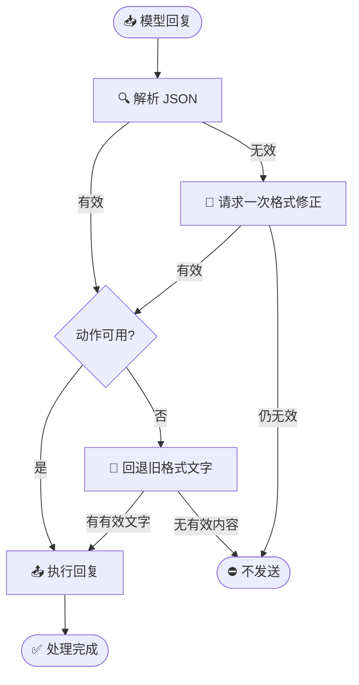

# 处理日志问题修复说明

_Linux 微信机器人 · 2026 年 10 月 26 日_

---

## 📋 概览

这次修复针对最近处理日志里暴露的三类问题：表情包定位失败、模型回复结构不合规导致整条回复丢失，以及模型输出 JSON 格式错误后无法恢复。

修复已部署到服务器，微信仍保持登录。针对性回归检查共 **30 项通过**。部署时没有发送真实聊天消息，因此这份结果证明代码路径和服务健康检查正常，不代表完成了手机端真实收发验收。

## 🔧 修复内容

### 表情包选择更能适应列表滚动

微信收藏表情列表会动态刷新和复用可见项目。旧逻辑连续滚动多格后再按旧位置计算目标；列表短暂重建时可能失去可靠对应关系，造成定位失败。

现在改为逐格滚动并重新读取当前可见项目。处理中段收藏时，程序使用连续页面共享的原生项目标识对齐索引；遇到短暂歧义会继续尝试。完整列表和末页仍沿用对应的索引定位方式。点击前还会核对收藏顺序、目标会话，以及目标项目是否可见且可点击；条件不满足时停止发送。

### 回复动作结构异常时保留有效文字

模型可能提供不可用的动作数组，但同时带有旧格式的文字回复。以前这种情况会让整条回复被判为格式错误。

现在会检查动作数组是否含有可执行的文字或已知表情包动作。没有可用动作时，优先回退到有效的旧格式回复；没有有效回复内容时仍不发送。

### JSON 格式错误时进行有限恢复

解析器现在可从 JSON 前后的简短说明文字中提取一个完整 JSON 对象或数组。若首次生成的回复仍无法解析，且本轮没有图片输入，系统最多追加一次仅用于修正格式的请求，不增加图片、贴吧等工具动作。

恢复请求若判定应旁观，则不发送消息；恢复失败时也不会把无法确认的结构化内容直接发出去。

## ✅ 验证与部署

| 项目 | 结果 |
| --- | --- |
| 回复习惯与格式恢复 | 10 项通过 |
| 原生消息发送与表情定位 | 10 项通过 |
| 表情库格式解析 | 10 项通过 |
| 服务健康检查 | 正常，15 个后台任务无失败 |
| 微信版本与登录状态 | 4.1.1.8，已登录 |
| 真实聊天消息 | 本次未发送 |

部署发布目录为 `/opt/whalegirl-linux/releases/log-repair-20261026-174349-446143366`。部署过程保持微信主进程、消息读取服务、容器和运行配置不变，也未重启原生微信。

代码变更提交为 `974750b`（`fix: recover malformed replies and sticker selection`）。服务器部署报告记录在 `/opt/whalegirl-linux-assets/log-repair-deployment.json`；部署前源码备份和测试日志保存在同一 assets 目录下的 `log-repair-before-20261026-174349-446143366`。

## ⚠️ 尚未由本次修复处理

- 模型接口返回 HTTP 402 属于账户余额或计费状态问题，需要检查模型服务账户。
- 一分钟内达到 9 条的发送拦截属于现有发送上限；这次没有调整该配置。
- 个别图片记录没有可用原图或缩略图，当前代码无法从缺失的源文件还原图片。

这些情况与本次代码修复分开处理。部署后健康检查正常，但需要后续真实会话出现相应场景时，才能确认用户侧表现。
