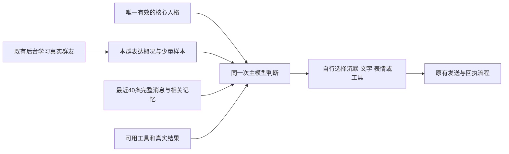

# 自然群聊：精简行为指令与打通表达学习

日期：2026-11-02（北京时间）

实施状态：已在工作区完成，并通过隔离回归、真实模型回放和桌面/手机后台测试。按用户随后补充的要求，取消新旧版本切换，统一使用新版；原卡与历史数据保留。实施结果与实际不足见 [NATURAL_CHAT_UPGRADE_20261102.md](NATURAL_CHAT_UPGRADE_20261102.md)。尚未部署、修改生产配置或推送 Git。

## 这轮范围

用户觉得机器人唠叨、说话违和，希望学习群友真实的语气和方式，保留 deepseek酱完整核心人设，减少冲突限制，增加自主判断。以下调查记录来自规划阶段；后续实现与测试已完成，详见上述结果文档。没有修改生产角色卡、配置或数据库，没有部署、推送、删除文件或发送真实微信测试消息。

本计划接替上一轮“继续补行为规则”的做法。此前本地候选保留为对照，下一步从最新生产与本地差异出发，只保留对消息可靠性、身份和资料来源有用的改动，不把所有候选补丁叠加上线。

## 一、核实到的问题

### 1. 截图是两轮输入，各自又扩成多步表达

在当前生产只读日志中找到对应时间：

| 发送时间 | 对应入站类型 | 机器人文字 | 原生表情 |
|---|---|---:|---:|
| 11-02 08:08:18 | 文字 | 1 | 1 |
| 11-02 08:08:31 | 表情 | 2 | 1 |

这两轮共 5 个动作，内容从确认吃完，延长到照顾、猜眼神、解释自己管太多、继续安排上课。单纯把每句话缩短，仍会留下多次解释和关心。

### 2. 多层行为要求在同时调同一个声音

生产角色卡仍为 7515 字符、22 个小节；除了身份、关系和世界观，还包含省略号、每轮人设表现、自检和情境反应要求。运行时又叠加聊天习惯、温度、好感度、场合、情绪、体验成长和表情节奏。库依赖数量本身不能证明自主性不足；这些输入中的行为要求及其组合更值得优先做对照验证。

当前部分设置：每轮上限 6 个动作，人设浓度高、顺着演意愿高、主见低；表情总体积极性 very_high，目标 85%，文字搭配积极性 100。它们不是单独的故障，但当前文字引导容易让模型把温柔理解为持续照顾，把积极表情理解为说完还要补图。

### 3. 学习有运行，表达习惯的出口不够清晰

只读最近 120 轮诊断：118 轮加载过记忆，82 轮加载过学习来源记录，43 轮加载过 chat_style/expression 风格内容。当前角色可见的活跃 chat_style 记录为 4 条，活跃 persona 类经验为 40 条。不能据此声称学习完全没生效，也不能把加载次数当成实际学会。

源码上的具体问题：

- `memory_parts()` 把风格和人物事实、偏好、事件放进同一个条数/Token 预算；当前 8 条、1400 Token。
- `MemoryHub.recall()` 的风格特判与 subject 是否属于当前人物有关。归属于某位来源群友的群表达习惯，不一定在该群其他人说话时也能稳定进入上下文。
- 输入主要是抽象“新认识”，缺少足够的“在什么对话里怎样接”样本。存了黑话释义不等于学会语气、接话和收尾。
- 多处规则重复强调温柔、先接情绪、主人优先；学到的简短表达即使加载，也可能被这些要求盖过。

上述是代码和样本支持的排查方向；各层影响需要同模型、同输入对照，不能只凭规则字数断言因果。

审计文件：`artifacts/prompt-simplification-20261102/production-audit.json`、`cadence-audit.json`。只保留统计，不在公开文档转载私人聊天或完整提示词。

## 二、参考方案与取舍

- [SillyTavern 角色设计](https://docs.sillytavern.app/usage/core-concepts/characterdesign/)把角色身份与对话风格示例作为可组织的材料；[Prompt Manager](https://docs.sillytavern.app/usage/prompts/prompt-manager/)也包含历史、世界信息等多个部分。借鉴一致的人设与少量风格样例，不据此推断“仅一张卡、完全没有外围规则”。
- [MaiBot 配置](https://docs.maibot.chat/manual/configuration/bot-config)区分人格、参与方式和表达风格；[记忆与学习说明](https://docs.maibot.chat/faq/memory-and-learning)区分各聊天流的表达/黑话使用与学习。借鉴分群表达学习，不引入整套额外 Planner、向量服务或随机风格切换。
- 用户给的雨希本地插件 README 与代码显示，它也有上下文注入和调度。可借鉴观察真实交流、给模型当前状态，不复制随机不回、故意记错或强制插话。
- [dsh-fish](https://github.com/ssamurias/dsh-fish)强调从反馈积累认知；[dsh-bili-humanism](https://github.com/InariNGT-Ofiicial/dsh-bili-humanism)把外部见闻积累与人格片段区分开。借鉴有来源、可反思的学习，不让外部材料覆盖完整核心人设。
- B站检索找到了[部署与活人感教程](https://www.bilibili.com/video/BV1S3nQ6EEDf/)等入口；视频页本次返回 412，未完成视频画面和字幕核验。上述实现依据来自可读取文档和源码，不能称为看完视频后复刻。

## 三、目标结构

身份与关系保持稳定；日常怎么开口、要不要接话、怎样结束一轮，更多由模型结合真实语境和群风格决定。无需每轮生成理由、内心独白或自然度评分。

## 四、计划修改

### A. 先精简输入中的行为规定

先生成一份有效提示词的来源清单和冲突表，每条标明来自角色卡、设置还是代码。随后合并同义规定，停用相互矛盾的重复注入。保留完整原卡和差异记录，不直接清空设定。

| 拟移出/合并的行为要求 | 调整方向 |
|---|---|
| 每条必须带温柔感、人设特征、小动作或停顿 | 用稳定性格描述表达她是谁，不要求每轮展示特征 |
| 省略号、口癖、反问和句尾语气的密集规定 | 让语气参考本群真实表达；保留清楚表达的基本要求 |
| 把亲近反话统一解释成撒娇、必须哄或认错 | 交给上下文判断；温柔不等于一律退让 |
| 到某时段默认犯困、催睡，或看到吃饭就持续照料 | 时间是事实资料；是否关心取决于当前互动与偏好 |
| 多句必须拆气泡、文字后再接表情 | 模型直接给完整的有序表达；已有长度/动作上限只是代码保护 |
| 多个模块分别指挥口吻、温度、情绪和亲近方式 | 核心人格统一表达底色，其他模块提供关系或状态资料 |
| 表情频率追赶、默认文字和表情捆绑 | 保留积极性偏好，允许表情代替文字，不追赶配额 |
| 每轮反套路熔断、自检和越来越长的纠错段落 | 以真实样本和简短偏好代替；不加更多禁词和模板 |

完整核心身份、主人关系、温柔为主与轻微傲娇腹黑、伙伴关系、兴趣、世界观保留。首先缩减行为补丁文本，暂定以减少一半为对照目标；不按字数硬砍角色事实，不为达成比例删掉必要工具协议。

涉及入口：`habit_static_prompt()`、`warmth_prompt()`、`persona_live_dynamic_prompt()`、好感度语气渲染、`experience.STATIC_PROMPT`、运行时分散追加的聊天要求。底层模块不因本计划被整体卸载。

### B. 让学来的说话方式在该群真正使用

复用既有后台 `grow_once()` 和统一记忆库，增加明确的本群表达使用通路：

1. 从真实群友的连续交流学习句子长短、衔接、收尾、玩笑的接法、表情作为回应的用法；不只收集梗的释义。
2. 一条表达经验带原文来源、适用语境和必要例外。样本以他人交流为依据，机器人自己的旧口癖不作为学习标准。
3. 从现有 chat_style/expression 派生一份短小的本群表达概况，带少量实际对话样本。先试 2～3 组，不建立第二个事实库或全量聊天副本。
4. 群表达不因原始来源群友本轮没发言而失效，也不必碰到“短句”等词才加载；另有一个很小的风格预算，避免与事实记忆争全部额度。
5. 梗、旧事件仍按当前语境检索，不把所有学到的梗常驻输入。风格是表达偏好，不能改身份、认主或群权限。
6. 先用已授权群的现有记录建立初始概况；之后复用后台时机增量更新，变化确实有意义才发布新版本。不会每轮改 system 或多调用一轮模型。
7. 各群分别形成表达习惯。可跨会话继承的是不含隐私的通用表达偏好，例如更少重复解释、自然收尾；具体原话样本、群黑话和共同经历留在来源群，不把群里某个人的口气原样复制到私聊。个人偏好继续按既有授权跨会话使用；私聊的亲密尺度不复制进群聊。这也让截图所示私聊能从语言学习中受益。

学习结果不以“新增了几条记录”验收，要看到未用来学习的后续对话中确实改变了表达与收尾。并不承诺出现固定次数就一定学会。

### C. 处理连续输入被各自扩写的问题

文字后跟表情都保留、都理解，但不默认每个输入都需要独立的“文字—表情—解释—再关心”循环。

- 复用既有消息缓冲与等待机制，针对同一人正在连续输入时合并，不把所有消息固定多等几秒。
- 区分同一消息后补的图片/标签与真正新发言；读取补全不应自动变成新一轮重复回复。
- 如果上一轮已接住内容，随后一张表情可以只是态度补充。模型仍能只回表情、接一句新玩笑或不发，不要求忽略表情。
- 待回复上下文明确呈现“你刚回应了什么、后面新增加了什么”，不用让模型逐条履行回复任务。

“吃完了”后可以一句短话、一个表情或自然结束；不预写唯一正确台词，也不把这条案例做成关键词规则。技术求助、有新意思的碎碎念仍能多说。

### D. 保留工具能力，把发送选择交回同一模型

搜索、记忆、图库、生图、表情、贴吧与主动聊天继续使用已有接口。工具说明写清能做什么和实际结果含义，减少用多个外层话术规定何时必须调用、调用后必须说什么。

不追加前置判断模型、逐条拟人化审稿或随机性格变化。只说文字、只发表情、混合、沉默和主动开聊沿用同一条决策路径。

原有代码继续处理会话授权、群/私聊数据隔离、用户指定的唤醒与静默、总发送额度、付费生图日额度、重复发送保护和实际回执。精简性格要求不动这些功能。

### E. 后台展示要少而有用

放到现有“记忆与成长”页面，不再增加侧栏分组：本群学到的表达概况、少量来源样本、最近更新、是否实际加载，以及修改/撤销。学习与使用可分别控制，复用现有设置，不再添加一排口吻强度滑块。

## 五、顺序与验收

| 阶段 | 工作 | 验收 |
|---|---|---|
| 1 | 提示词来源审计、冲突合并、保留唯一核心人格 | 有可读的删改表；身份/关系/兴趣没有遗漏；固定行为补丁显著缩减 |
| 2 | 本群表达概况、真实样本、稳定使用入口 | 能证明来源、使用范围和本轮是否加载；群友换人也能参考本群习惯 |
| 3 | 连续输入与完成话题的节奏 | 文字+表情不会被机械扩成两套解释；不忽略表情，不以统一长等待拖慢单条问题 |
| 4 | 少量同模型对照与回归 | 看实际回复，再判断是否采用；不靠正则零命中宣称自然 |

对照时保持模型、温度、思考等级和最近 40 条上限一致。先测关键的 6～8 段连续交流，区分“只精简规定”和“精简+使用群表达”的作用；有具体疑点再扩大，避免大量低价值回放。

场景覆盖：事情说完后的短回应、文字接表情、熟人玩笑、别人互聊、普通不同意见、明确任务/技术问题、安静与重新唤醒。工具回归用假网关和已有测试，不发真实群聊测试或付费生图。

观察无信息补充、反复关心、猜动机、同义复述、实际动作数、是否自然结束，以及邀请时能否接住、工具任务是否照常执行。篇幅和消息数只是指标，不做运行时固定配额；不能以变冷淡、丢功能或答非所问来换短。

速度与缓存：不新增普通回复的模型阶段；静态人格和工具前缀稳定，群表达概况按版本缓存，动态信息仍在用户上下文中。比较输入量、顶层模型调用数和耗时；区分热缓存与冷缓存、模型耗时与手机送达，不承诺事前无法验证的固定命中率。

## 六、实施边界

已以最新生产基线和现有工作区差异审阅实施；对照快照只供审计，不提供旧版运行入口，不清空聊天或记忆库。旧配置中的模式字段兼容读入后统一采用新版，主动聊天、体验成长、学习与记忆仍可分别控制。

本轮没有进行删除操作。若后续确有文件或数据删除需要，执行前按 AGENTS.md 报告具体目标并检查命令。实现、测试和可审阅差异完成后，取得明确上线授权再修改生产。
