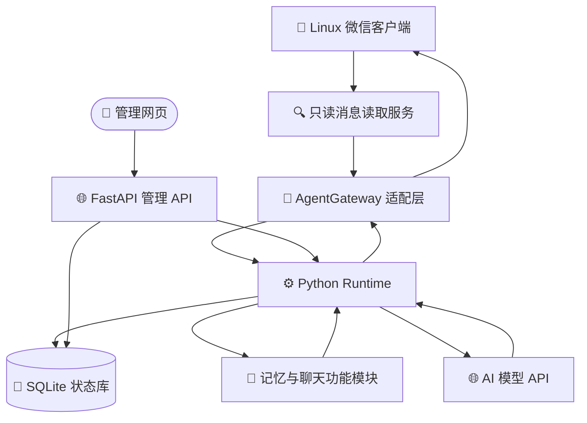

# Linux 微信机器人项目结构与功能交接

_交给接手 agent 的项目总览 · 更新于 2026 年 10 月 26 日_

---

## 📋 项目定位

这是一个运行在 Linux 服务器上的微信机器人项目。微信使用固定的 Linux 客户端 4.1.1.8；Python/FastAPI 核心负责收消息、上下文组织、AI 决策、管理网页和后台功能；原生客户端适配层负责登录、读取和发送，并对发送结果做读回核实。

仓库包含程序源码、网页、人设资源、专题文档、回归测试和部署工具。**生产数据与源码分离**：微信登录数据、机器人配置、消息数据库、长期记忆、图片素材、密钥、运行日志和备份均在服务器数据目录，克隆 Git 仓库不会自动恢复这些数据。

本文是面向接手 agent 的项目级地图。具体功能的交互规则和历史故障过程见对应专题文档。专题中的日期快照可能已过时；涉及生产开关和服务状态时应以服务器当前读数为准。

## 🧱 架构与消息处理

系统由原生微信容器、只读消息读取服务、Python 核心、SQLite 状态库、模型 API 和管理网页组成。原生微信与 Python 核心是分开的服务：管理 API 健康不等于微信在线，微信在线也不等于回复核心健康。



### 一条普通消息的处理路径

1. Runtime 轮询已授权会话，并用服务端账号状态确认当前微信账号。
2. 入站消息被标准化、去重并写入 SQLite；首次读取会建立历史基线，旧消息归档但不补发回复。
3. 根据会话触发规则判断是否入回复队列。群聊可配置为自然接话，或只响应 @、关键词、拍一拍等显式触发。
4. `debounce()` 合并短时间连续发言；参与意愿逻辑可以让机器人旁观，而不是对每条消息都回复。
5. `context.py` 组装当前会话、引用/转发、图片、记忆、关系、表情候选及启用的工具上下文。
6. 模型返回结构化决策；Runtime 校验动作、权限、配额、目标会话及发送间隔。
7. Gateway 调用原生微信发送；SQLite 写入动作记录，并读取本机微信消息确认结果。
8. 成功、失败、部分完成或结果不确定分别落库。发送结果不确定时暂停等待管理员核对，不自动重发。

发送确认用于避免把“API 接收了请求”误当成“微信确实发送成功”。它仍受客户端界面、消息同步、网络和微信服务器状态影响。

## 🗂️ 仓库结构

| 路径 | 作用 | 接手时先看 |
| --- | --- | --- |
| `whalegirl_linux/` | Python 应用、FastAPI、聊天运行时、网页资源和所有主要功能模块 | `runtime.py`、`app.py` |
| `whalegirl_linux/upstream/` | 从 DeepSeekGirl 改造的模型引擎和人设管理兼容代码 | `ai_engine.py`、`style_manager.py` |
| `styles/` | 内置角色提示词和风格资源 | `tsundere_whale_girl.yaml` |
| `deploy/` | Linux 服务定义、客户端适配、诊断、测试辅助和按功能拆分的部署脚本 | 先阅读所选脚本及其专题文档 |
| `deploy/legacy/` | 旧版本或阶段性部署工具；前置条件可能已不成立 | 不要当作通用安装器 |
| `tests/` | 核心逻辑、管理 API、原生适配和功能模块测试 | 与改动对应的 `test_*.py` |
| `references/agent-wechat-source/` | Agent WeChat 上游源码 Git 子模块，固定到提交 `21fe1185a01ec7f90864a529d9bb94da648255d5` | `.gitmodules`、`THIRD_PARTY.md` |
| 根目录 `*.md` | 项目总结、操作要求、交接与功能专题文档 | `AGENTS.md`、本文、专题文档 |
| `requirements.txt` / `requirements.lock` | Python 依赖声明与锁定信息 | 修改依赖时同步评估锁文件 |

本地 `.venv`、测试运行数据和部署现场产物不是可移植的生产数据。`.gitignore` 明确排除了运行数据库、配置密钥、令牌、证书、日志、截图、二维码、安装包和临时部署归档。

## ⚙️ 核心模块与实现方式

### 应用与消息核心

| 文件 | 责任 |
| --- | --- |
| `whalegirl_linux/__main__.py` | Uvicorn 入口，绑定 `127.0.0.1`，默认端口 `8092`，限制连接并发和关闭等待 |
| `whalegirl_linux/app.py` | FastAPI 工厂、管理 API、网页资源路由、登录与配置边界、后台服务生命周期 |
| `whalegirl_linux/runtime.py` | 核心编排器；轮询、入队、回复决策、模型调用、发送、归档及后台循环 |
| `whalegirl_linux/gateway.py` | Agent WeChat HTTP API 客户端；会话、消息、登录、媒体、UI 作业、原生文字/图片/表情和引用发送 |
| `whalegirl_linux/store.py` | SQLite 持久化；消息收件箱、历史、游标、发送动作、媒体状态、回复指标和上下文 |
| `whalegirl_linux/settings.py` | Pydantic 配置验证、配置持久化、认证材料管理和授权文件同步 |
| `whalegirl_linux/context.py` | 每轮上下文、媒体关联和视觉输入准备 |
| `whalegirl_linux/conversation.py` | 回复动作计划、自然接话提示、参与意愿、温度/表达和文字配表情策略 |
| `whalegirl_linux/message_payload.py` | 解析入站原生消息及引用、转发等 payload |

Runtime 启动的 15 个循环任务目前包括：收件轮询、回复 worker、历史归档、表情索引、安全检查、记忆摘要、朋友圈、图片任务/生成/元数据/通知、贴吧浏览/发送、自主聊天和学习提议。健康接口会报告后台任务数量及异常退出数量。

### 功能服务

| 功能 | 主要实现文件 | 行为概述 |
| --- | --- | --- |
| 自然聊天与参与意愿 | `conversation.py`、`runtime.py`、`habits.js`、`conversation.py` | 防抖合并、旁观/参与判断、回复拆分、引用选择、表情搭配和节奏设置 |
| 群聊 @ | `mentions.py`、`deploy/native_group_mentions.py` | 按群成员真实 ID 匹配昵称并生成原生 @；是否允许由总开关和会话规则控制 |
| 长期记忆 | `memory.py`、`runtime.py`、`app.py` | 会话事件隔离；经配置允许的个人偏好/事实按真实 sender ID 跨会话召回；后台可编辑、归档和撤销 |
| 好感度 | `affection.py`、`affection.js` | 按人物 ID 维护可见关系分值，支持总开关、锁定与修订；群聊语气边界独立于私聊 |
| 聊天学习 | `learning.py`、`learning.js` | 从聊天生成带来源提议，审核/采纳/修改/撤回/到期；是可审阅经验库，不是模型权重训练 |
| 表情库 | `stickers.py`、`sticker_library.py`、`sticker_assets.py`、`sticker-library.js` | 建立 MD5 到原生收藏的映射，保存含义标签，支持 AI 收藏、编辑、保护、停用和恢复 |
| 图片库与生图 | `images.py`、`image_tools.py`、`image_references.py`、`image_retention.py`、`images.js` | 图库发送、生图任务队列、图片编辑、角色参考图、图库范围控制和保留策略 |
| 图片定位与显示 | `media_locator.py`、`visible_media.py` | 将消息 ID 与实际媒体源绑定，优先获取原图/缓存；不可用时保留失败状态，不以相邻图片替代 |
| 朋友圈 | `moments.py`、`moments_payload.py`、`moments.js` | 读取客户端可见的动态和评论，草稿/发送/回复，并按真实结果回读确认 |
| 百度贴吧 | `tieba.py`、`tieba_tools.py`、`tieba_archive.py`、`tieba_retention.py`、`tieba.js` | 兴趣浏览、原文和图片归档、梗检索、按需读取/分享和过期管理 |
| 联网搜索 | `search.py` | 对话中按需调用模型搜索/读取工具；失败时不伪装成已查到最新资料 |
| 主动聊天 | `proactive.py`、`proactive.js` | 在管理员授权会话中判断是否主动接话、继续话题或暂停；生产开关需现场读取 |
| 角色卡 | `personas.py`、`personas.js`、`personas.css` | 创建、预览、切换、归档和恢复角色卡 |
| Token 统计 | `token_usage.py`、`token-usage.js` | 记录供应商回报的输入、输出、缓存等用量字段；不以字符数猜算 token |
| 安全与稳定性 | `safety.py`、`stability.py`、`resources.py`、`deploy/core_watchdog.py` | 发送额度、重复拦截、失败暂停、资源检查与核心健康恢复 |

图片、朋友圈和贴吧等功能虽然共享基础设施，但开关、权限、来源标记和配额各自独立。不能因为代码中有某个功能就假定生产配置已启用。

### 管理网页

`web.html` 是控制台主页面；`console.js` / `console.css` 负责导航、状态和通用管理交互。记忆、学习、好感度、表情、图片、贴吧、朋友圈、主动聊天、角色卡及 Token 页面由对应的模块脚本和样式提供。

管理 API 集中在 `app.py`。除 `/health`、静态页面资源和登录入口外，`/api/*` 使用 Bearer 会话认证；控制台密码和模型密钥不应写入仓库或交接文档。OpenAPI 页面默认关闭。

### API 分组入口

以下是接手时常用的 API 路径分组；完整参数和校验规则以 `app.py` 中的路由实现为准。

| 路径前缀/端点 | 用途 |
| --- | --- |
| `GET /health` | 服务健康和后台任务状态 |
| `/api/auth/*` | 控制台登录、注销 |
| `/api/state`、`/api/config`、`/api/prompt` | 运行状态、模型与人设配置 |
| `/api/gateway/*`、`/api/messages*`、`/api/recent` | 微信会话、入站消息、媒体记录 |
| `/api/memory*`、`/api/affection*`、`/api/learning*` | 记忆、好感度、学习经验 |
| `/api/stickers*`、`/api/sticker-library/*` | 微信原生表情目录与管理 |
| `/api/images/*`、`/api/moments/*` | 图片库、生图任务和朋友圈 |
| `/api/tieba/*`、`/api/proactive/*` | 贴吧与主动聊天 |
| `/api/safety*`、`/api/stability*`、`/api/token-usage` | 发送保护、稳定性日志和 Token 账本 |

## 🗄️ 配置与运行数据

生产核心默认使用环境变量 `WHALEGIRL_DATA_DIR` 指定的数据目录和 `WHALEGIRL_GATEWAY_URL` 指向的本机网关。当前部署路径如下：

| 内容 | 服务器位置 |
| --- | --- |
| 活动版本 | `/opt/whalegirl-linux/current` |
| 不可变历史发布 | `/opt/whalegirl-linux/releases/` |
| Python 虚拟环境 | `/opt/whalegirl-linux/venv/` |
| 配置、SQLite 与运行数据 | `/var/lib/whalegirl-linux/core/` |
| 微信 4.1.1.8 容器数据 | `/var/lib/whalegirl-linux/candidate-4.1.1.8/` |
| 稳定性采样 | `/var/lib/whalegirl-linux/stability/` |
| 部署报告与备份 | `/opt/whalegirl-linux-assets/` |

SQLite 主状态库为 `state.sqlite3`。基础收件箱和发送账本在 `store.py`；记忆、好感度、学习、Token、图片、表情、朋友圈和贴吧服务会在同一数据库中创建各自表。图片二进制、角色参考图和少数导出/元信息文件保存在数据目录下的独立子目录。

服务器服务结构：

- `whalegirl-linux.service`：Python/FastAPI 核心，仅监听回环 `127.0.0.1:8092`。
- `whalegirl-wechat-candidate-4118`：Docker 内的 Linux 微信 4.1.1.8 客户端及上游网关；宿主端网关走本机回环端口。
- `whalegirl-native-reader.service`：通过私有本机通道运行的只读 SQLCipher 消息读取辅助服务。
- `caddy.service`：管理网页反向代理；公网入口/HTTPS 隧道由独立入口服务提供。
- `whalegirl-stability.timer`、`whalegirl-core-watchdog.timer`：服务器端稳定性采样与 Python 核心健康检查。

Windows 侧只用于开发、SSH 管理和打开控制台入口；它关闭后不会停止服务器上的机器人或采样器。

## 🎛️ 功能总览与重要边界

| 能力 | 项目内行为 | 已知边界 |
| --- | --- | --- |
| 聊天 | 私聊/群聊授权；自然接话或按 @、关键词、拍一拍唤醒；短消息合并和模型动作计划 | 历史消息范围受 Linux 客户端本地同步情况限制 |
| 图片理解 | 当前消息、引用图片和已保存图像描述可进入上下文 | 不是 Windows OCR；没有原图或缩略图时无法恢复 |
| 原生表情 | 只把真实微信 type 47 且 MD5 匹配视为原生表情发送 | 收藏面板虚拟化与微信 UI 状态会影响定位 |
| 记忆 | 群事件按群隔离；个人偏好/事实按设置和真实 ID 共享 | 模型提取的语义仍需后台审核；不等于事实已验证 |
| 图片工具 | AI 可选择图库、生图或历史图；图库与生成任务分离 | 生图服务较慢，任务状态与发送状态是不同阶段 |
| 朋友圈 | 发动态、回复自己动态评论、评论好友动态等分开控制 | 依赖本机已同步数据及原生 UI；UI 锁会与聊天发送互斥 |
| 贴吧 | 保存原文、图片和学习梗；检索及分享由工具触发 | Cookie、来源、授权和当前开关需从生产设置确认 |
| 保护机制 | 本地发送额度、重复内容拦截、失败/不确定暂停 | 不是微信官方风控指标，不能保证账号不受限制 |

三条维护原则：

1. 不要把网页可打开当成微信在线证据，分别检查 `/health`、`/api/state` 和容器状态。
2. 不要对不确定发送、掉线或扫码问题盲目重试；先读日志与待核对状态，涉及手机确认时由用户操作。
3. 不要承诺永久在线或 24 小时稳定，除非检查实际连续采样记录并确认没有缺口。

## 🧪 测试与部署工作流

### 新 agent 本地准备

```powershell
git clone --branch backup/local-snapshot-20261024 --recurse-submodules https://github.com/Akie-qiu/whalegirl-linux.git
Set-Location .\whalegirl-linux
python -m venv .venv
.\.venv\Scripts\Activate.ps1
python -m pip install -r requirements.txt
python -m unittest discover -s tests -v
```

克隆子模块时会取得锁定版本的 Agent WeChat 源码。无需生产密钥即可运行模拟测试；本地启动完整管理服务或连接真实微信需要独立的安全运行配置，不要从聊天记录或旧日志复制凭据。

### 本地测试

测试使用模拟网关和模型，不应连接真实微信或发送真实聊天。按改动范围跑相关测试；需要全量时：

```powershell
python -m unittest discover -s tests -v
```

常用针对性检查：

```powershell
python -m unittest discover -s tests -p "test_chat_habits.py" -v
python -m unittest discover -s tests -p "test_native_delivery.py" -v
python -m unittest discover -s tests -p "test_images.py" -v
git diff --check
```

`tests/` 覆盖聊天核心、发送/表情、消息恢复、记忆、学习、图片、朋友圈、贴吧、角色卡、搜索、主动聊天、模型控制和稳定性。针对性检查通过不等于完成真实微信收发验收。

### Linux 发布

部署脚本是按功能迭代建立的专项工具，不是通用安装器；有些脚本引用固定活动发布、备份路径或特定校验文件。生产改动前：

1. 先读仓库 `AGENTS.md`、本文件、对应专题文档、部署脚本和它的调用链。
2. 确认分支和工作区；从 `backup/local-snapshot-20261024` 继续，不要默认旧的 `main` 分支代表生产代码。
3. 做最小功能修改和相关测试；确认没有在途发送、待核对状态或微信掉线。
4. 保留原发布及服务器备份，以不可变新 release 和受控切换为优先；勿重建/升级微信容器来部署纯 Python 修改。
5. 部署后快速核对核心健康、后台任务、微信登录、容器重启数、读取服务、配置哈希和最终用户可见行为。
6. 只有获得用户指定会话授权后才发真实验收消息。写清楚测试范围和没有验收的部分。

用户要求：Windows 命令使用 PowerShell，不用 `cmd`；删除前先向用户说明具体对象并详细检查删除命令。不要删除旧 release、运行数据或备份来“清理”。

## 📍 交接时的生产与 Git 状态

**2026 年 10 月 26 日现场复核：**

- 活动发布：`/opt/whalegirl-linux/releases/log-repair-20261026-174349-446143366`。
- `/health` 返回 `status=ok`、15 个后台任务、失败任务 0、微信版本 4.1.1.8。
- `/api/state` 只读快照：总开关开启、没有暂停、网关状态 `logged_in`。
- 微信容器为运行状态、重启计数 0；原生读取服务、稳定性采样 timer 和核心 watchdog timer 均为 active。
- 本次日志修复部署没有发真实聊天消息；不要把模拟测试说成真实手机端验收。
- 本文编写时没有重新判定是否已达到连续 24 小时稳定性观察标准；接手后应核对 `latest.json`、`tracking.json` 与采样覆盖。

Git 当前应从 `backup/local-snapshot-20261024` 开始。本文制作时该分支 `HEAD` 为 `ed66205`，远端已同步；`main` 是更旧的快照分支。最近一次业务修复提交为 `974750b`，文档提交为 `cffd1c4`、`ed66205`。

当前日志修复的单独说明见 [LOG_REPAIR_20261026.md](LOG_REPAIR_20261026.md)。线上报告记录健康状态、进程保护边界和部署文件；服务器报告不是代码仓库的一部分。

## ⚠️ 已知问题与不应误判的日志

- 模型接口 HTTP 402 通常需从模型服务账户余额/计费状态排查，不是消息发送器或微信登录故障。
- 发送额度拦截是本地设置生效，不代表微信账号被风控；调整前先读管理后台实际配置。
- 缺少原图或缩略图的媒体记录不能靠模型恢复；检查媒体原件路径和 reader 返回状态。
- 机器人处理日志中的回复计划不等于微信已成功发送。核对 `outbound_actions`、最终消息读回和状态字段。
- `failed`、`blocked`、`ignored`、`partial` 和 `uncertain` 是不同结果；不确定状态不能当作发送失败后直接重试。
- 文档中 10 月 20 日、24 日的资源、PID、耗时和版本描述是历史事实，不代表当前状态。以本次现场读数和 `/opt/whalegirl-linux-assets/` 下对应部署报告为准。
- 学习提议、贴吧梗库、消息日志及长期记忆是不同数据，不要把一类内容当成另一类已经生效。

## 📚 文档与专题入口

| 文档 | 适合了解 |
| --- | --- |
| [AGENTS.md](AGENTS.md) | 仓库操作硬要求 |
| [PROJECT_SUMMARY.md](PROJECT_SUMMARY.md) | 用户视角的项目能力总览 |
| [HANDOFF_AGENT_20261024.md](HANDOFF_AGENT_20261024.md) | 详细的 10 月 24 日历史交接；时间快照已过时 |
| [STABILITY_FIX.md](STABILITY_FIX.md) | 微信/核心掉线、OOM、进程和 watchdog 历史 |
| [CHAT_HABITS.md](CHAT_HABITS.md)、[CHAT_PERSONALITY.md](CHAT_PERSONALITY.md) | 接话、人格参数和输出节奏 |
| [CONVERSATION_V2.md](CONVERSATION_V2.md)、[QUOTES_AND_FORWARDS.md](QUOTES_AND_FORWARDS.md) | 消息上下文、引用与合并转发 |
| [MEMORY_RECALL.md](MEMORY_RECALL.md)、[AFFECTION.md](AFFECTION.md)、[LEARNING_20261026.md](LEARNING_20261026.md) | 长期记忆、关系好感度和聊天学习 |
| [STICKER_LIBRARY.md](STICKER_LIBRARY.md)、[STICKER_STUDIO.md](STICKER_STUDIO.md) | 原生表情语义库和管理 |
| [IMAGE_TOOL_PLAN.md](IMAGE_TOOL_PLAN.md)、[IMAGE_TASKS.md](IMAGE_TASKS.md)、[REFERENCE_IMAGES.md](REFERENCE_IMAGES.md) | 图片库、生图任务与角色参考图 |
| [MOMENTS.md](MOMENTS.md)、[MOMENTS_REPLY_TIMELINE_FIX.md](MOMENTS_REPLY_TIMELINE_FIX.md) | 朋友圈功能和历史修复 |
| [TIEBA.md](TIEBA.md)、[TIEBA_TOOLS_20261025.md](TIEBA_TOOLS_20261025.md) | 贴吧采集、归档、检索、分享及工具 |
| [SEARCH.md](SEARCH.md)、[TOKEN_USAGE.md](TOKEN_USAGE.md)、[PERSONAS.md](PERSONAS.md) | 搜索、用量统计和角色卡 |
| [THIRD_PARTY.md](THIRD_PARTY.md) | 上游来源与固定版本 |

---

_文档只描述本仓库可见实现及交接时实测状态，不包含服务器凭据、微信登录数据、模型密钥或聊天原文。_
