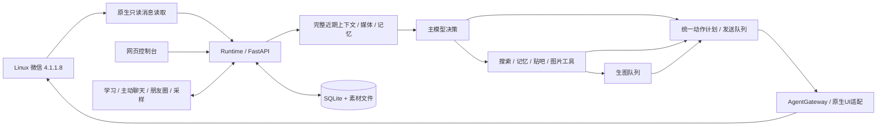

# 鲸鱼娘 Linux 微信机器人：完整项目介绍与 Agent 交接

更新日期：2026-11-01，北京时间。本文覆盖当前本地代码及本次实际部署。旧文档里的“当前发布”“在线”“已验收”仅代表当时的快照，不能当作现在的状态。部署详情见 `DEPLOYMENT_20261101.md`。

## 1. 接手前先读这些

| 项目 | 当前事实 |
|---|---|
| 本地目录 | `D:/appData/qqbot/wechat-linux` |
| Git 分支 | `backup/local-snapshot-20261024` |
| HEAD | `96aaadd`，`Wait for incoming photos before generating image replies` |
| 完整代码在哪里 | 工作区有大量已修改及未跟踪文件；**HEAD、GitHub 都不等同于最新完整版** |
| 生产服务器 | `root@120.46.186.50`；SSH 免密连接，凭据不写进文档 |
| 当前实际发布 | `/opt/whalegirl-linux/releases/humanization-bugs-20261101-20261101-201156-558562461` |
| 保留的上一发布 | `/opt/whalegirl-linux/releases/soul-review-fixes-20261031-20261031-162459-29669` |
| 发布入口 | `/opt/whalegirl-linux/current` |
| 原生微信 | 固定 Linux 微信 **4.1.1.8**，容器 `whalegirl-wechat-candidate-4118` |
| 核心/读取服务 | `whalegirl-linux.service`、`whalegirl-native-reader.service` |
| 本次服务检查 | 核心健康、19任务0失败；微信恢复为logged_in/login_success，机器人启用且未暂停 |
| 本次实际部署 | 两轮拟人化/互动连续性升级、生图、length、贴吧素材修复；与服务器独立差异合并后发布 |
| 本次备份 | `/opt/whalegirl-linux-assets/humanization-bugs-20261101-before-20261101-201156-558562461`，含一致性数据库和私有配置 |
| Git边界 | 没有提交或推送；GitHub仍不等同于最新工作区/生产版本 |

### 操作规则和用户偏好

1. 先阅读根目录 `AGENTS.md`。本机只用 PowerShell / pwsh，不用 cmd。
2. 用户随后明确说“部署吧”，授权了本次上线与必要的备份、增量迁移和核心重启；未授权推送Git。后续不相关的线上变更和生产数据编辑仍需相应授权。
3. 保留其他 Agent 和用户的未提交修改；禁止为了“干净”执行 reset、clean 或覆盖整棵工作区。
4. 删除任何文件/数据/缓存前，先报告具体目标、检查最终绝对路径与命令。测试产物也不要自行批量删除。
5. 不改 QQ 部署，不随意升级/重启原生微信，不盲目循环登录。
6. 不输出密钥、维护令牌、登录数据、聊天原文、完整提示词或含图片 base64 的任务 JSON。
7. 线上数据库只通过 SQLite `mode=ro` 读取。**不能为只读查看创建 `Store`、`Runtime` 或 `Config`**，这些构造器会迁移、恢复任务状态或创建凭据文件。
8. 真实微信测试消息需要明确目的会话和授权。最近的真实模型测试授权是“读取模型配置、合成对话、假网关”，不是对群友发消息的授权。
9. 用户更重视自然聊天、回复效果和速度；不喜欢无意义确认、随机装人、固定话术或增加大量串行检查。

## 2. 项目要实现什么

这是以原生 Linux 微信客户端收发、Python/FastAPI 编排、浏览器管理的长期运行机器人。核心角色仍是用户配置的完整 deepseek酱：温柔为主，轻微傲娇和腹黑，群聊保持朋友边界。借鉴雨希的是理解语境、参与节奏和成长机制，**不复制雨希的台词或性格，不替换用户人设**。

项目覆盖聊天、原生表情、图库/生图、引用与转发解析、群友识别、分层记忆、好感度、选择性学习、自主聊天、轻量公开阅读、贴吧素材、朋友圈和网页控制台。存在的平台/供应商限制需要如实暴露，不能把“点击过发送”记成已送达。

## 3. 架构与进程



- 核心入口：`python -m whalegirl_linux` → `__main__.py` → `app.create_app()` → `Runtime.start()`。
- FastAPI 绑定回环地址，默认 8092；网页经反向代理/隧道通常使用 18092。网关默认 `127.0.0.1:6175`；实际部署以 systemd 环境和覆盖配置为准。
- `AgentGateway` 处理网关 HTTP、原生任务文件、UI 锁、账号状态与发送。只读读取服务和核心可独立重启；尽量不动原生微信登录会话。
- `Runtime.start()` 当前建立 19 个任务：轮询、工作线程、归档、表情、保护、摘要、朋友圈、图片派发、生图、图片元数据、图片状态提醒、贴吧浏览、贴吧派发、主动聊天、学习、自主观察、恢复、成长、发送流水线。
- 生图长请求不占图片派发线程；普通文字生成可与其他会话发送重叠。同一会话发送顺序和微信 UI 仍需串行协调。
- `deploy/` 含特定历史版本的发布脚本、原生脚本、watchdog 和 systemd 示例。不能将某个旧 stage/deploy 脚本直接当作通用发布器。

主要依赖：Python 3.12 环境下已运行测试；FastAPI、Uvicorn、HTTPX、Pydantic、PyYAML、Loguru、Cryptography、Pillow、WebSockets、aiotieba。版本范围在 `requirements.txt`，锁定信息在 `requirements.lock`。前端为原生 JavaScript/CSS，无需另建 SPA。

## 4. 消息到回复的实际流程

1. 读取消息并规范化 account/chat/sender_id、时间、local/server ID、类型、引用、转发和媒体。自己发言仍可进入历史，但不作为新真人唤醒。
2. `Store` 持久化消息、入站状态和游标；消息别名去重，首次同步不把全部旧历史当新问题。
3. 会话许可、严格唤醒、静默、过期与总开关决定能否处理。严格群保持 @/拍一拍/关键词规则。
4. 防抖合并连发；模型可按开关调用 `wait_for_next_message` 暂等补充。等待只影响本会话，恢复后不重复等待。
5. `context.py` 按时间提供最近 **40 条**完整交流，后台可调 **10–100 条**；另有字符预算和针对性历史召回，不能承诺任意长消息永不截断。近期消息不按关键词筛掉。
6. 图片按真实消息身份和引用关联；刚传输的图片可有界等待/重读。没有实际图像不编造描述，不借用别人的图补空缺。
7. 主模型读取固定人设/规则和动态消息/记忆等；决定旁观、文字、原生表情、混合动作、引用、@、搜索与图片请求。
8. 工具只在需要时运行，实际结果进入后续模型决策。结构化决策字段不等于 OpenAI 原生函数：项目同时使用 JSON 字段工具和 native function calls。
9. `plan_actions` 与格式保护清理不该对用户显示的内部标记，按既有设置拆段。图片任务独立持久入队，不等待一两分钟生图再回复普通消息。
10. 统一发送保护和 `AgentGateway` 实际发送，确认本人新消息、真实类型/内容/标识。结果分别为 sent、failed、uncertain。
11. 确认回执再记录相应成功行为；后续正常轮询可补齐 uncertain。结果不确定不自动重发，不将自己的输出当新真人学习证据。

静默命令、账号切换、角色切换、配置 generation 变化和发送许可必须在异步边界再次核对。不要因拟人化绕开这些已有控制。

## 5. 模块导航

以下文件均位于 `whalegirl_linux/`，原生部署辅助代码位于 `deploy/`。

| 模块 | 职责/修改入口 |
|---|---|
| `app.py`、`settings.py` | 管理 API、认证、配置校验、角色/模型设置持久化 |
| `runtime.py` | 入站判断、模型与工具编排、队列、耗时指标、任务生命周期 |
| `gateway.py`、`delivery.py`、`fast_send.py` | 原生收发、账号确认、UI 操作、回执和有限恢复 |
| `reply_pipeline.py` | 一个生成器/一个发送器，跨会话重叠，同会话保序 |
| `context.py`、`message_payload.py`、`media_locator.py`、`visible_media.py` | 近期历史、图片、引用、合并转发及媒体定位 |
| `time_context.py` | 服务器时间和消息时间的输入位置；动态块不能破坏固定前缀 |
| `upstream/ai_engine.py`、`model_reply.py` | 多协议模型请求、usage、结束状态、JSON/工具结果保护 |
| `conversation.py`、`chat_control.py` | 参与、表达、动作选择、静默与唤醒 |
| `personas.py`、`upstream/style_manager.py` | 完整人设/角色卡、内置风格加载 |
| `autonomy.py`、`proactive.py`、`proactive_tools.py` | 自主参与、待续意图、主动聊天和共享工具链 |
| `experience.py` | 社交背景、来源可靠的经历、未决事件、完整互动学习输入 |
| `memory.py`、`memory_hub.py`、`memory_layers.py` | 统一记忆、证据/修订、作用域、分级召回和摘要 |
| `learning.py`、`growth.py` | 学习提议、采纳/撤回、闲时公开阅读、成长预算 |
| `affection.py` | 唯一人物好感度、锁定/修订、群/私聊表达差别 |
| `stickers.py`、`sticker_library.py`、`sticker_assets.py` | 原生表情目录、标签、选图、收藏/停用、原生定位 |
| `images.py`、`image_tools.py` | 三类图库、图像元数据、候选选择、任务队列、生图/发送/提醒 |
| `image_references.py`、`image_canvas.py`、`image_retention.py` | 人设/聊天参考图、4K比例、图片保留策略 |
| `search.py` | 独立 DeepSeek Search/Fetch，聊天模型换供应商不必换搜索 |
| `tieba.py`、`tieba_tools.py` | 贴吧阅读、兴趣、梗、搜索原文、摘录分享 |
| `tieba_archive.py`、`tieba_retention.py` | 原文/图片归档与未用资料保留策略 |
| `moments.py`、`moments_payload.py` | 朋友圈排期、草稿、发帖/评论、目标定位及回执 |
| `moments_world.py`、`moments_creativity.py`、`world_document.py` | 生活世界、多人剧情、角色关系、减少重复主题 |
| `safety.py`、`recovery.py`、`resources.py`、`stability.py` | 配额、暂停、统一恢复、资源与稳定性状态 |
| `store.py`、`token_usage.py` | 核心 SQLite、消息/动作状态、token及缓存账本 |
| `web.html`、`console.js/css`、各功能 `.js/.css` | 分组管理面板，前端资源版本号需随修改更新 |

## 6. 模型、缓存、速度与工具预算

- 模型卡固定有 flash/pro/responses/custom 槽位；每张卡保存自己的 URL、Key、模型名、协议和思考/流式选项。切换不能覆盖另一张卡的地址与密钥。
- 协议包括 Chat Completions、Responses、Anthropic Messages。原生函数工具目前走非流式 Chat Completions；其他协议按既有 JSON 工具结果路径处理。
- 搜索和生图使用各自配置/密钥，不随聊天模型卡无意覆盖。
- 静态人设、规则、稳定素材目录放前缀；时间、实际消息、相关记忆、候选变化放动态区。`request_fingerprint` 保存系统/工具哈希和字符数，不保存提示词正文。
- 不为了降低输入删掉用户要求的完整近期40条；默认图库静态目录为最新20张，有明确内容时先检索最新20张，不合适再查旧资料。
- token账本记录输入、输出、cache hit/miss/write、reasoning、功能、耗时和成功/失败。必须统计失败请求，缓存命中不能拿本地估算冒充供应商实值。
- **本次 length 修复**：已知 DeepSeek 思考模型或显式设置思考强度的非流式 openai/responses 请求，在正文预算外留 low=1024、其他=2048 的余量。不改人设、思考等级或消息上下文；明确 token 截断最多在既有总尝试上限内重算一次，第二次输出上限不超过16384，不拼接半截工具参数。
- 输出余量是容量，不是强制生成这些 token；但可能增加实际推理耗时和费用，不能承诺账单不变。成长任务的预算预留同步计入此余量。默认主链成功不增加模型调用。
- 流式路径未做这次预算/重试改造，保持原来的完整结束检查。内容过滤、上下文超限、400/401等不按 token 截断处理。
- 6–10秒是用户普通聊天目标，不是对生图、搜索、网络故障和所有微信UI动作的硬保证。分析时区分收取、排队、防抖、上下文、模型、发送队列、文字/表情回执各阶段。

## 7. 记忆、人设与自然成长

### 统一数据，不叠加独立“日记数据库”

原始聊天、可编辑长期记忆、模型学习提议分层保存。会话经历属于对应群/私聊；明确个人偏好按真实 sender_id 共享，仍遵守管理员选择的跨会话范围，不能只凭同昵称合并人。好感度共用，但群聊不应变成私聊式暧昧。

记忆包含来源、证据、修订、版本、锁定、归档与恢复；分核心/稳定/普通/冷层，先用摘要，需要细节才查深层。管理员撤回要同时影响旧内容召回，不能后台改了还从旧摘要复活。

### 本地拟人化升级的关键

- `autonomy_enabled && experience_growth_enabled` 生效；持久写入同时服从记忆和 `memory_auto_capture` 开关。
- 群聊摘要来自真实近期发言：人数、机器人已说多少、消息长度和表情比例；是模型可参考的背景，不是强制概率配额。
- `experience_update` 用真实 `source_key` 和逐字 evidence 写入 `memories` 的 `shared_moment`、`source_class=experience`；可选 `summary/feeling/phase/continues_id`。
- `phase` 是 open/uncertain/resolved；最多提供同角色/会话半小时内两条未决经历。新真人证据可修正原理解；旧版本、未提供ID、跨会话/角色、锁定/归档和重复来源拒绝覆盖。
- `autonomy_intents` 区分 followup 和 unsaid。unsaid 是相关时可接的话，不会单独触发定时打扰；可以完成、取消、过期。
- 后台学习看有限的完整互动链：新增真人证据、前文、账号自身历史和已确认本角色发送。自己复读、发送失败、无人回应、单个笑声不能直接当认可证据。
- 强化提议需要独立真人证据，重放不加分；保留审核、核心身份锁定、适用条件、例外、撤回和角色绑定。
- 新版移除了强制短吐槽、固定台词、默认困倦反复注入；温柔是处事倾向，不要求每轮安慰或追问。
- 没有储存模型隐藏思考过程。所谓“未说出口”是短意图记录，经历感受是可审计摘要。

上一轮实模小样本能跟随话题、澄清和倾诉/建议切换，群友互聊可旁观；但自动事件留档在样本中没有出现，不能宣称已验证长期自然成长。详见两份 HUMANIZATION 文档。

## 8. 原生表情、图库和生图

### 表情

原生收藏表情按 MD5/原生身份选取；发送图片或GIF不能冒充原生表情成功。入库一次识别语义，保留情绪、场景、可见文字、不适用条件等。模型可选纯文字、纯表情、混合次序；保留积极性调节及群体风格背景。

AI 收藏和从可选库停用受会话权限控制，管理员可编辑、禁用、恢复；停用不删除微信收藏。文字和表情有各自额度，同时保留账号总量。原生面板虚拟化、翻页与收藏变动仍可能引发定位错误。

### 三种图库

`picture_assets.source`：uploaded、generated、tieba。还有独立的角色参考图库，不要混成普通可发送素材。素材带 account、scope、scope_chat、入库 created、描述和启用/保留状态。

明确点名某个图库只能在该来源内选。模糊请求优先最新入库，明确角色/画面先匹配内容，再按新旧排序。用途 scenes 不是画面证据；找不到贴吧图不能偷偷调用收费生图。

图片工具在主模型决策中使用 `image_request`：`send_library_image` 选择已有资产，`generate_image` 创建或修改任务。可一次选1–3张已有图；修改/取消只允许本人相关尚可修改的任务。多角色生图保留各角色实际参考图，不只把名字写进提示词。

### 任务状态与本次修复

- 生图：queued → generating → ready → sending → sent；终态另有 failed/uncertain/cancelled。destination 可为 library/chat/moments。
- 已提交生图按北京时间计入每日额度；取消或不确定不等于供应商没有收费。重新发送已有图片不再生图。
- `generate_once` 与 `process_once` 独立；4K按长边4096换算比例，实际供应商输出仍须查看素材尺寸。
- 有参考走 `/images/edits` multipart，无参考走 `/images/generations` JSON；不通过换端点重复下单兜底。
- **新增 `picture_jobs.diagnostics_json`**：生成提交/返回/解码/下载/保存阶段、HTTP状态、下载尝试、原始错误、管理员核对；不保存签名URL或供应商正文。后台能查看阶段和核对前的原错误。
- 已生成结果 URL 下载可重试一次GET；收费POST在超时/5xx/不确定时不自动重投。兼容正常base64以及带data URI/空白的图片编码；错误编码不当作已成功。
- 图片回执先落库，再执行统计；统计异常不能把已成功图片改成失败。
- 状态提醒在模型完成、登录检查后都重新核实；已成功、已人工核对、待发送回执、过时或同人更新任务已成功的旧提醒不发。
- 后续轮询若拿到**同一原生 local_id** 的真实成功回执，可以修正之前失败的图片记录；不重发图片、不用模糊匹配认领其他人的图。

## 9. 贴吧、阅读和朋友圈

贴吧使用 aiotieba 和可访问素材；保存感兴趣原文、原图、帖子来源，后台可查看/编辑梗和描述。`search_tieba/read_tieba/share_tieba` 为按需工具，不把整个原文库塞入每轮输入。分享摘录须来自实际原文，并带来源链接；不是只生成一句评论就声称分享了内容。

素材入库后还要有实际视觉标签才能自动候选；未标注/失败/禁用/删除的素材与已标注的45张等统计不能混为一谈。本次修复把来源词清洗放在语气词前，避免“贴吧”被拆坏后要求图片描述含“贴”。保留来源、主题和权限过滤。

贴吧总开关 `tieba_enabled`、图片开关 `tieba_images_enabled`、成长来源 `growth_tieba_enabled` 是不同层；代码默认总贴吧和成长贴吧关闭，实际服务器用户设置可能开启。主动分享还服从时段、额度、会话静默和冷却。不能因“没分享”就无条件解禁。

`GrowthService` 在闲时按兴趣读取公开轻量内容，做有来源的理解和记忆；可形成一次可选分享机会。它不是浏览器挂机，不会为学习自动在B站/贴吧发布评论，也不应把外部资料当系统指令。

朋友圈支持自动排期/草稿、第一人称文字、配图、生成图片、多AI娘生活世界。回复自己的动态评论和好友动态评论有独立开关。评论定位必须知道动态和评论对象，不能只凭同昵称。任务在 `moments_actions` 持久化，配图准备和UI发布分开。发布成功/不确定需真实读回，不可重复点击造成重复发帖。

## 10. 持久数据与备份边界

生产数据根：`/var/lib/whalegirl-linux/core`。数据库是 **`state.sqlite3`**；本次只读发现同目录 `state.db` 是0字节旧占位，不能据此误判数据丢失。

| 数据 | 内容 |
|---|---|
| `settings.json` | 当前配置和完整提示词等，属于私有配置 |
| `model-profiles.json`、`model-api-keys.enc` | 模型卡配置及加密密钥 |
| `encryption.key`、其他 `.enc`、管理/网关令牌 | 恢复密钥所需的私密材料；禁止进Git/日志 |
| `persona-cards.json` | 角色卡 |
| `state.sqlite3` 与 WAL | 消息、动作、记忆、成长、任务、账本 |
| `pictures/` | 上传/生成/贴吧素材；以代码中的来源目录为准 |
| 角色参考目录 | 由 `ReferenceLibrary` 按账号管理；普通图片资产不能替代 |
| `tieba-archives/` | 原文 original.txt、source.json、归档图片及元数据 |
| 原生容器数据/稳定性目录 | 微信登录、数据库、媒体及 `/var/lib/whalegirl-linux/stability` 采样；不等于核心源码 |

SQLite重要表：

- 消息：inbox、message_log、history、archives、baselines、poll_progress、reply_metrics、image_cache。
- 发送：outbound_actions、safety_state/events、chat_quiet_state。
- 记忆：memories、memory_evidence/origins/revisions/dependencies/suppressions、memory_work_queue、memory_summaries、chat_digests。
- 成长：learning_proposals/revisions、persona_mood_state、autonomy_chats/intents/events、proactive_chats/runs/people、growth_runs/state/sources/journals/insights。
- 图片：picture_assets/jobs/decisions/sources/deletions；表情：sticker_library及修订/候选/会话权限/usage。
- 贴吧：tieba_posts/memes/pictures/shares、archives/archive_images、tool_events、lifecycle/cleanup_log、索引和缓存关联表。
- 朋友圈：moments_actions/state/world_state/world_events；账本：model_token_usage/meta；好感度：affections及修订。

源码备份与完整数据备份不同。在线SQLite不要只复制主文件忽略WAL，使用一致性备份方法；数据库、素材和加密密钥需要配套。用户此前选择“服务器完整备份＋本机代码和配置”，不要擅自再开始大体积全量下载。

## 11. 后台/API和排查入口

前端按分组面板提供会话、模型、人设、表情、记忆成长、自主聊天、图片、朋友圈、贴吧、日志、恢复和token。API主体在 `app.py`，认证中间件统一保护；不能为了测试绕开鉴权。

| API族 | 用途 |
|---|---|
| `/api/config`、模型卡相关路由 | 配置与模型切换 |
| `/api/messages`、`/api/messages/image` | 消息和可用媒体 |
| `/api/memory-hub`、`/api/memory`、`/api/learning`、`/api/persona-state` | 记忆、修订、学习、人设状态 |
| `/api/autonomy`、主动聊天相关路由 | 当前意图、经历和主动参与控制 |
| `/api/images`、`/api/images/jobs/{id}` | 图库、任务、人工核对；核对不重发 |
| `/api/sticker-library`、`/api/stickers` | 原生表情管理 |
| `/api/tieba` 相关路由 | 原文、梗、分享、素材和保留策略 |
| `/api/moments`、`/api/moments/world` | 动态、评论、世界文档和角色参考 |
| recovery、token、stability 相关路由 | 集中恢复、账单、稳定性；具体路径以路由定义为准 |

排错先看 `reply_metrics` 的阶段耗时和 `model_response.finish_reason`，再看 picture_jobs、outbound_actions、tieba_tool_events 等关联状态；不要只看模型说“发了”或后台回复文本。日志抽取只输出脱敏错误、时间、状态、计数和字段名。

## 12. 本次三个问题的结论

1. **length**：线上近三天有23条相应聊天失败，后台多项任务输出token全部耗于reasoning；部分初始工具响应也在有正文时截断。本地已补预算和有界重算，不执行截断JSON。
2. **生图/误报**：用户确认既有真实生成失败，也有成功后报错。最新两条失败任务的原始原因被人工核对覆盖，不能再凭空断言具体供应商根因。已修复确认覆盖诊断、提醒异步竞态、成功后统计异常降级、结果下载瞬断等代码问题；供应商403、5xx、真正超时仍可能发生。
3. **贴吧素材发送**：已复现“贴吧”被粒子清洗破坏导致候选空缺；本地修复并用假模型/假网关测完整选材入队发送。未对真实群发图做手机端验收。

详细变更与测试证据：`THREE_BUGS_20261101.md` 和 `artifacts/three-bugs-20261101/`。241项回归通过，最后补充两项暂停/旧提醒检查并回跑26项通过，合计243个不同用例。本轮真实模型探测验证完整生图决策和原生等待工具，没有实际收费生图或微信发送。以 `final-tests.log`、`notice-guard-tests.log` 及实模报告为准，不把旧失败尝试日志当最终结果。

## 13. 本地测试与后续部署

使用现有 `.venv/Scripts/python.exe`；裸python命令在此电脑不可靠。测试主要为 unittest，pytest未作为依赖安装。测试使用合成消息和假网关，输出目录在 `test-runs/`，不要连接真实数据运行测试。

```powershell
Set-Location -LiteralPath 'D:\appData\qqbot\wechat-linux'
$env:PYTHONPATH='tests'
$env:PYTHONIOENCODING='utf-8'
$env:LOGURU_LEVEL='ERROR'
.\.venv\Scripts\python.exe -m unittest test_three_bug_regressions test_images test_image_tools test_picture_receipts test_chat_pipeline_repair test_responses test_model_controls test_tieba_tools -q
node --check whalegirl_linux/images.js
git diff --check
```

主程序启动会创建后台任务。检查代码/配置时不要随意启动真实Runtime；需要手动演示应使用独立 `WHALEGIRL_DATA_DIR`、关闭enabled及外部功能、使用假网关。

若用户后续授权部署：先重新只读核对 current和服务器文件哈希，比较任务diff与两轮拟人化差异，保留线上其他Agent改动；做新发布目录，准备一致性数据备份，仅执行增量迁移，必要时重启Python核心，原生微信保持登录。发布后核对配置、人设、模型卡、队列、核心健康、微信账号、静态资源及关键真实输出。当前没有为本轮制作或执行部署脚本。

本次迁移仅新增 picture_jobs.diagnostics_json，旧表数据保留。拟人化升级另有角色范围和来源规则变更，因此不能假定整个项目回滚到任意旧二进制都兼容；行为回退优先使用开关并验证作用域。

## 14. 已知限制与后续优先级

- 本次已完成差异部署，服务器微信在部署前已退出，现已重新核对登录成功。手机端实际图片送达和长期行为仍需分别验收。
- 原生表情面板、朋友圈UI和微信登录依赖客户端状态，不承诺永不失败。只读服务active不等于登录有效。
- 生图供应商没有返回可查询任务接口时，超时后无法可靠追认结果；保持不确定，不重复收费。原始错误已被旧管理操作覆盖的历史任务无法恢复诊断。
- 新的推理余量可能增加输出费用，重试最多一次不等于从此不会length；需观察真实模型和预算。未经实测不宣称缓存命中或延迟完全不变。
- 自然程度取决于真实模型与长期交流；上一轮实模仍有省略号偏多、回复偏满和个别建议客服化。代码测试不证明已复刻雨希的自然程度。
- 事件自动记录积极性、长期成长质量、真正图片慢传、微信手机送达和长期稳定性仍需各自验收。
- 仓库庞大的未提交差异是交接风险。需要整理时先以当前工作区为基线建立清晰任务差异，不整库重置，不把生产数据推到公有GitHub。

## 15. 参考文档索引

- `THREE_BUGS_20261101.md`：本轮三处修复的证据、改动和测试。
- `HUMANIZATION_INTERACTIONS_20261031.md`：互动连续性、事件修订、完整反馈学习、224项历史回归及真实模型样本。
- `HUMANIZATION_UPGRADE_20261031.md`：体验成长、意图、社交背景、公开阅读接入。
- `YUXI_PERSONALITY_INTEGRATION_REVIEW_20261031.md`：雨希插件机制审查；不直接安装插件覆盖本项目。
- `MODEL_PROFILES_20261031.md`：模型卡独立URL/Key迁移。
- `PROJECT_OVERVIEW_20261031.md`、`PROJECT_HANDOFF_20261026.md`：历史概览；状态和行为变更以当前代码及新文档为准。
- `STABILITY_FIX.md`、`SOUL_REVIEW_FIXES_20261031.md`：资源、进程和前一发布审查。
- `IMAGE_TOOL_PLAN.md`、`IMAGE_TASKS.md`、`REFERENCE_IMAGES.md`、`CHAT_WORLD_RECEIPT_FIX_20261030.md`：图库、参考图及回执历史。
- `TIEBA_TOOLS_20261025.md`、`CHAT_PIPELINE_REPAIR_20261030.md`：原文工具、分享队列和媒体等待。
- `MOMENTS_WORLD_PLAN_20261030.md`、`WORLD_DOCUMENT_EDITOR_PLAN_20261031.md`：朋友圈生活世界与世界文档。
- DeepSeek思考/工具官方说明：https://api-docs.deepseek.com/guides/thinking_mode/ 。本轮核对后实现推理预算修复，不依赖关闭思考来掩盖截断。
